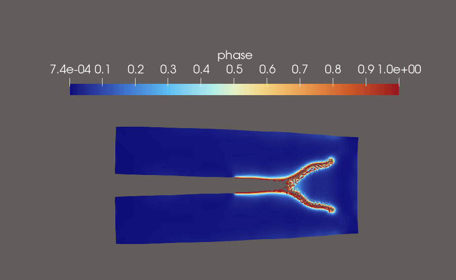
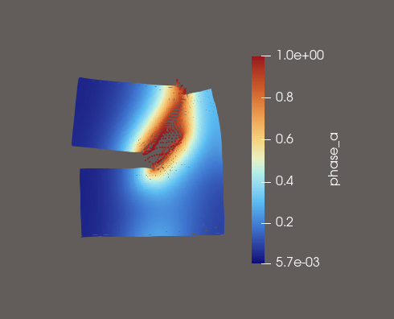

# MPM-PHASE-FIELD
Implementation of phase field fracture and anisotropy with the material point method (MPM).

The repo holds two self-contained sub-projects:

- [`serial_py/`](serial_py/README.md): the serial numpy implementation, and the reference for everything else.
- [`WARP/`](WARP/README.md): the GPU port with NVIDIA Warp.

# PHASE FIELD

*<b>Figure 1.</b> Dynamic crack branching in a pre-notched plate, single phase field $\phi$ coloured from 0 (intact, blue) to 1 (fully broken, red). The crack runs straight from the notch tip and splits into two branches once the tip speed saturates — the classic branching instability. Explicit MPM, deformation scaled.*

Clasic PF formulation with a sigle fracture field. Crack density functional:

$$
\gamma (\phi, \nabla\phi)= \frac{1}{2}\left[\frac{1}{\ell_0}\phi^2+\ell_0(\nabla\phi\cdot\nabla\phi)\right]
$$

# ANISOTROPIC PHASE FIELD

*<b>Figure 2.</b> Pre-notched plate with layers oriented at $\theta = 60^\circ$, coloured by the interfacial field $\alpha$ from 0 (intact interface, blue) to 1 (fully broken interface, red). The crack leaves the notch tip and turns to follow the layer direction rather than the loading direction. Explicit MPM, deformation scaled.*

In this formulation, there are two phase fields, the bulk fracture PF $d$ and the interfacial fracture PF $a$. Crack density functional for each field:

$$
\gamma (d, \nabla d)= \frac{1}{2}\left[\frac{1}{\ell_0^{d}}d^2+\ell_0^d(\nabla d\cdot\nabla d)\right]
$$

$$
\gamma (\alpha, \nabla \alpha)= \frac{1}{2}\left[\frac{1}{\ell_0^{\alpha}}\alpha^2+\ell_0^{\alpha}(\nabla \alpha\cdot\mathbf{A}\cdot\nabla \alpha)\right]
$$

## Symbol Appendix

| Symbol | Description | SI units |
|---|---|---|
| $G_c$, $g_c^{d}$, $g_c^{\alpha}$ |Fracture toughness | J/m² |
| $\ell$, $\ell_d$, $\ell_\alpha$ | Phase-field regularization length scale | m |
| $\mathbf{A}$ | 2nd order structure tensor   | - |